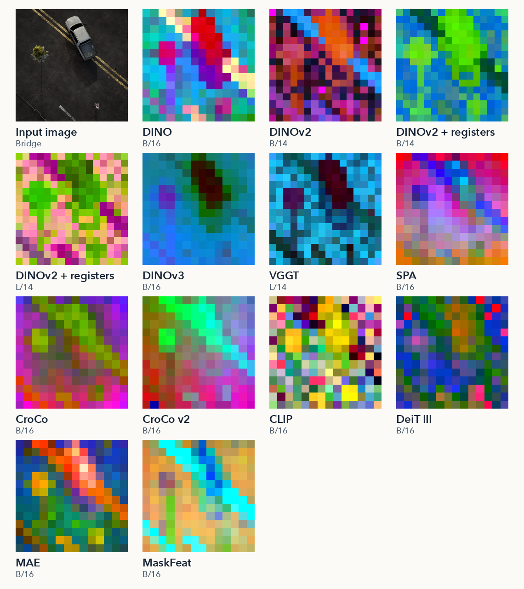
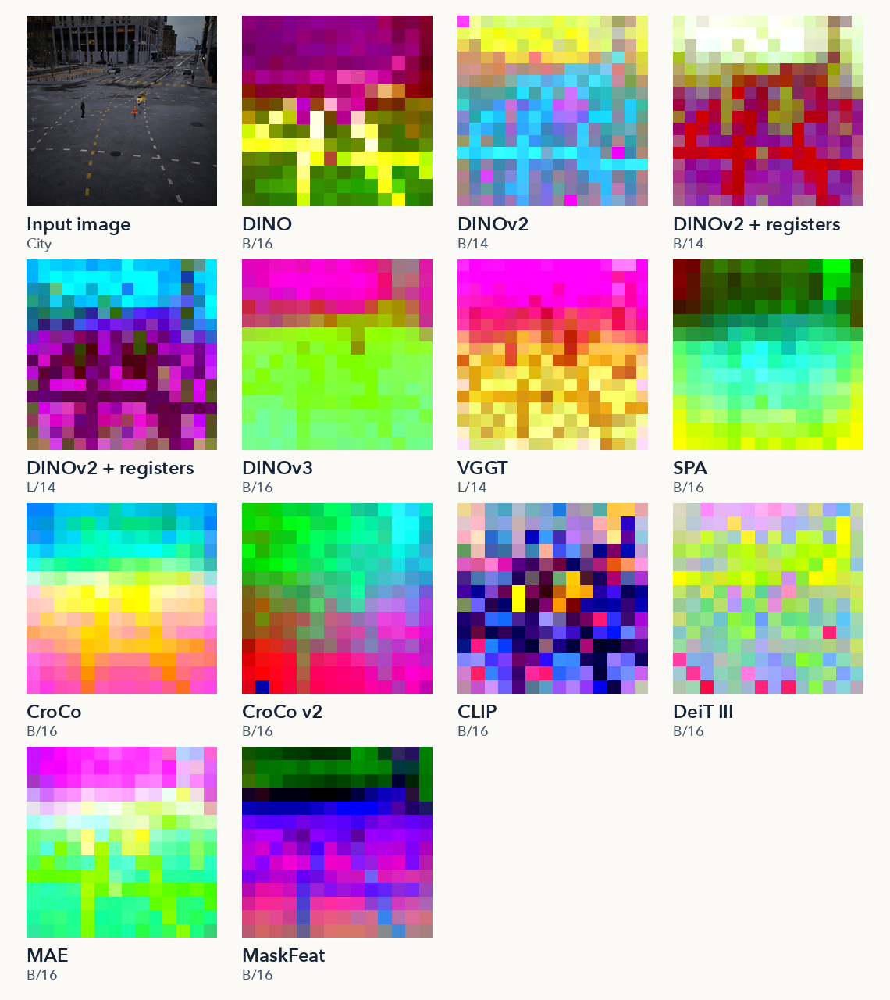
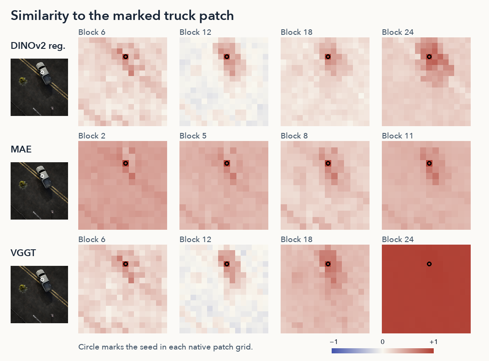
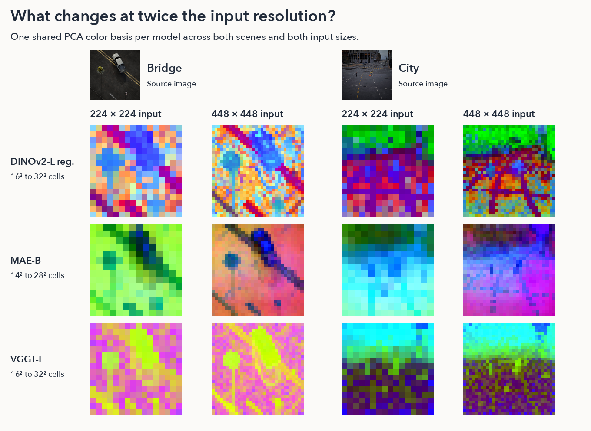
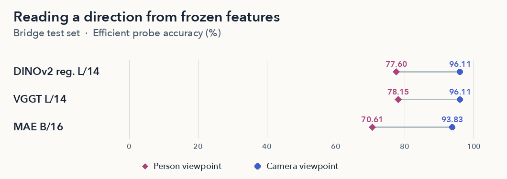

# One SpaRRTa scene through the eyes of 13 vision models

Look at the pickup on the bridge. From the camera, the truck is to the right of the tree. Now find the person near the bottom of the image and try answering from their viewpoint. You have to use the scene differently, even though every pixel stays the same. What information does a frozen vision model give you to work with?

We ran the 13 backbones in the SpaRRTa results tables on this image and on a city intersection. Two of them, DINOv2-L with registers and VGGT, reach exactly **96.11%** with an efficient probe on the Bridge camera task. Yet when we pick a patch on the truck and ask which other patches look similar to it, the two models give strikingly different maps. [SpaRRTa, Tables 3 and 4](https://arxiv.org/html/2601.11729v3)

<!-- more -->

## Find the truck, then find the person

Each square in a feature map represents one image patch. A backbone describes that patch with hundreds of numbers. We used FeatLens to project those features onto three principal components and display them as red, green, and blue. Look for where a region begins and ends. On the bridge, can you follow the truck across the yellow lane markings? Can you still pick out the much smaller person? [FeatLens](https://turhancan97.github.io/FeatLens/)

=== "Bridge · truck and tree"

    

=== "City · scooter and cone"

    

*Feature maps generated with FeatLens (Kargın, 2026). We fitted one color projection per backbone using both pictures. Colors therefore carry over between the Bridge and City panels for the same model. Each backbone has its own color axes. B and L denote the base and large encoders. The number after the slash is the patch width in pixels.* [Software citation](https://doi.org/10.5281/zenodo.21082488)

On the bridge, DINO gives the truck a long red region and preserves the light diagonal road markings on either side. DINOv3 also picks out the truck, but much of the road projects into a relatively uniform blue field. Switch to the City tab and the scale of the problem changes. The person, scooter, and cone occupy only a few patches. In several maps, the transition between the buildings and the road is easier to see than the boundary between the scooter and cone. An enlarged tile still contains only 14 × 14 or 16 × 16 measurements.

## Follow one patch through the network

Pick the truck cab as a reference. At each layer, we measured the cosine similarity between its feature vector and every other patch vector. The circle marks the reference patch. Red means a similar direction in feature space, white means a similarity near zero, and blue means an opposing direction. Every panel uses the same scale from −1 to +1.

*FeatLens cosine similarity on the Bridge image. The seed is at 55% of the image width and 24% of its height. Block numbers count from one. The MAE row follows the hidden states selected by the SpaRRTa wrapper.* [FeatLens cosine implementation](https://github.com/turhancan97/FeatLens/blob/fb0c339a92eb7014d8ea7887e352b76b2d424097/featlens/methods.py)

Three readings from that figure are worth comparing:

- **DINOv2-L with registers.** At block 24, the cab patch has a similarity of **0.59** to a patch on the truck bed and **0.16** to one on the tree. The truck is visible as a connected region of higher similarity.
- **MAE.** At block 11, the cab-to-bed similarity is **0.71**, while the cab-to-tree similarity is **0.36**. Much of the road also has positive similarity to the cab. The fixed scale lets us see that higher background level.
- **VGGT.** The truck is visible at block 12. By block 24, even the *least* similar patch scores **0.973** against the cab. The same layer's PCA map still outlines the truck. Cosine measures the angle to one vector, whereas PCA stretches directions of variation across the collection of patches. Small differences between nearly parallel vectors can therefore be visible in the PCA image.

## What changes at twice the input resolution?

We ran the same Bridge and City images through these three encoders again at 448 × 448. Doubling the input width and height gives each model four times as many spatial tokens. Look at the tree to the left of the truck in the Bridge panels. At 448, you can follow its trunk below the crown and trace the lane markings alongside the pickup.

*Each row uses one FeatLens PCA color projection fitted to equal numbers of patches from both scenes and resolutions. Within a row, the colors are comparable across all four panels. DINOv2 and VGGT go from 16 × 16 to 32 × 32 cells, and MAE goes from 14 × 14 to 28 × 28.*

Does the finer grid change which patches resemble the truck cab? We kept the cab, bed, and tree sample coordinates fixed. At 448, each sampled patch covers a smaller part of the original image.

| Backbone | Bridge patch compared with the cab | Cosine at 224 | Cosine at 448 |
|---|---|---:|---:|
| DINOv2-L with registers | Truck bed | 0.589 | 0.433 |
| DINOv2-L with registers | Tree | 0.162 | 0.231 |
| MAE-B | Truck bed | 0.710 | 0.573 |
| MAE-B | Tree | 0.364 | 0.371 |
| VGGT-L | Least similar patch in the image | 0.973 | 0.972 |

For DINOv2 and MAE, the bed remains more similar to the cab than the tree does, though the gap narrows. VGGT gives the clearest example of why the choice of visualization matters. Its 448 PCA map shows a finer truck outline, yet the least similar patch still scores 0.972 against the cab, rounded to three decimals. These two scenes tell us how the features respond to resolution. Measuring direction-prediction accuracy at 448 would require a separate probe evaluation.

## What can a probe recover?

The four numeric columns below are **published test accuracies (%)** for SpaRRTa's efficient probe at the benchmark's 224 × 224 input resolution. Each number summarizes an environment and viewpoint across many test images. The short observations refer only to the two images shown above. We generated the feature maps for this post and took the accuracies from the benchmark. [SpaRRTa, Tables 3 and 4](https://arxiv.org/html/2601.11729v3)

| Backbone | Training signal | What to look for in these maps | Bridge camera | Bridge person | City camera | City person |
|---|---|---|---:|---:|---:|---:|
| DINO B/16 | Self-distillation across image views | The truck and the diagonal road paint both stand out. | 89.86 | 62.25 | 82.45 | 64.89 |
| DINOv2 B/14 | Self-distillation and masked-patch prediction | The orange truck forms a single region amid isolated bright road patches. | 93.75 | 69.58 | 93.00 | 70.53 |
| DINOv2 reg. B/14 | DINOv2 training with register tokens | The truck and tree both appear bright green against the blue road. | 93.52 | 65.76 | 93.00 | 66.37 |
| DINOv2 reg. L/14 | DINOv2 training with register tokens | On the bridge, the green truck and tree separate from the pink road. In City, the lane markings are particularly distinct. | **96.11** | 77.60 | 94.27 | **73.61** |
| DINOv3 B/16 | Self-supervised distillation with Gram anchoring | The truck forms a dark silhouette. The city road spans a broad green region. | 94.82 | 69.28 | 92.40 | 68.83 |
| VGGT L/14 | Multi-task 3D supervision | The PCA map distinguishes the truck and tree even where the final cosine panel appears uniform. | **96.11** | **78.15** | **94.47** | 71.19 |
| SPA B/16 | Masked volumetric rendering | Broad color bands cross both scenes. The truck has a softer boundary than the DINOv3 silhouette. | 88.72 | 63.81 | 80.27 | 59.15 |
| CroCo B/16 | Cross-view completion | A diagonal green region follows the truck and road markings. City shows broad horizontal bands. | 92.68 | 67.35 | 87.95 | 66.01 |
| CroCo v2 B/16 | Cross-view completion | On the bridge, a small bright tree region sits beside a longer diagonal band through the truck. | 91.01 | 67.15 | 85.99 | 67.37 |
| CLIP B/16 | Image–text contrastive learning | The City map has isolated bright patches near the central objects amid a mottled road region. | 64.71 | 53.29 | 64.67 | 52.73 |
| DeiT III B/16 | Supervised image classification | A warm-colored truck region is visible on the bridge. The City road is mostly pale with small patches of contrasting color. | 81.40 | 56.47 | 76.50 | 60.19 |
| MAE B/16 | Masked pixel reconstruction | A bright strip runs through the truck and continues along the lane paint. The tree forms a separate yellow patch. | 93.83 | 70.61 | 89.00 | 68.88 |
| MaskFeat B/16 | Masked prediction of oriented gradients | The diagonal across the bridge dominates the map. The City map has a sharp horizontal transition near the base of the buildings. | 92.30 | 67.58 | 77.64 | 64.61 |

DINOv2-L with registers and VGGT tie on the Bridge camera task despite the difference in their cosine maps. On the Bridge person task, their accuracies are 77.60% and 78.15%. Even for a fixed backbone, the readout matters. VGGT's Bridge camera accuracy rises from **58.92%** with a linear probe to **96.11%** with the efficient probe. The images help us ask whether features group parts of a truck together. Predicting *where the truck is relative to the tree from someone else's viewpoint* requires a separate measurement. [SpaRRTa results](../../results.md)

## How we made the figures

We used the Bridge and City images from the project demo and the 13 checkpoints represented in the paper's main tables. For the 13-backbone gallery, each frozen encoder received one bicubically resized 224 × 224 RGB image at a time with SpaRRTa's ImageNet normalization. We kept the spatial tokens on their native grid and enlarged the colored cells with nearest-neighbor sampling. For each backbone we fitted FeatLens's robust three-component PCA jointly to the two grids with a fixed PyTorch seed of 24. The cosine computation used the original patch vectors. The bed and tree samples were at normalized image coordinates (0.61, 0.37) and (0.21, 0.39), respectively.

We selected the deepest feature exposed by the evaluation configuration. For MAE, the wrapper indexes a hidden-state sequence that includes the embedding output, so its deepest configured index is the output of **block 11 of 12**. For VGGT, SpaRRTa probes the single-image patch encoder before the multi-view aggregator. For CLIP, we used the LAION ViT-B/16 checkpoint and checked the patch outputs against OpenCLIP's native forward pass. These choices matter when comparing the figures to visualizations from another implementation. [SpaRRTa extraction code](https://github.com/turhancan97/SpaRRTa/tree/bb58d7c0faf26f85ce456b187321d30fe197e6df/sparrta/models) · [FeatLens revision used](https://github.com/turhancan97/FeatLens/tree/fb0c339a92eb7014d8ea7887e352b76b2d424097)

The figure data include the original 26 PCA maps, 12 layer-wise cosine arrays, and a manifest with the input image hashes, model configurations, and layer indices. The `resolution/` folder contains the 12 paired PCA maps, six Bridge cosine arrays, and the measurements for the resolution comparison. [Download the figure data](../../imgs/featlens/figure-data.zip)

**Software citation.** Kargın, Turhan Can (2026). *FeatLens: Model-agnostic feature-map visualization for vision models*. Version 0.3.2. Zenodo. [DOI 10.5281/zenodo.21082488](https://doi.org/10.5281/zenodo.21082488)

**Benchmark citation.** Kargın, Turhan Can, Wojciech Jasiński, Adam Pardyl, Bartosz Zieliński, and Marcin Przewięźlikowski (2026). *SpaRRTa: A Synthetic Benchmark for Evaluating Spatial Intelligence in Visual Foundation Models*. International Journal of Computer Vision. [DOI 10.1007/s11263-026-03112-7](https://doi.org/10.1007/s11263-026-03112-7)
